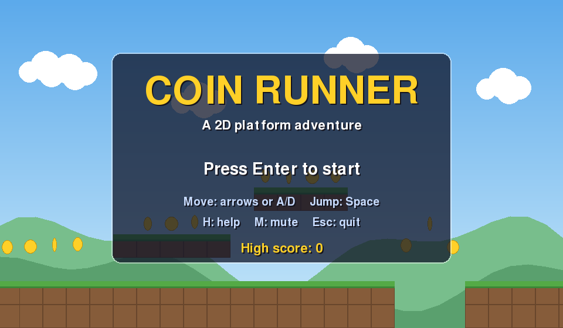
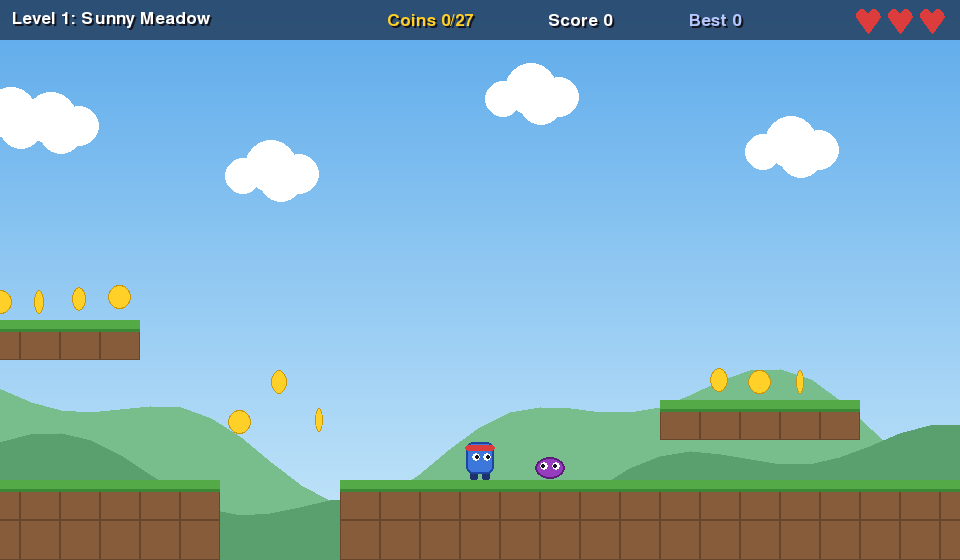
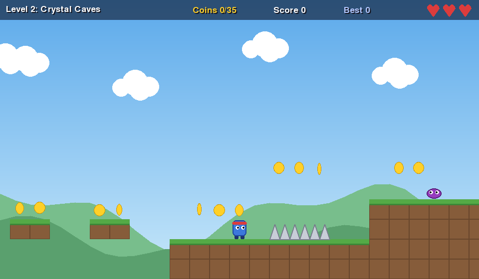
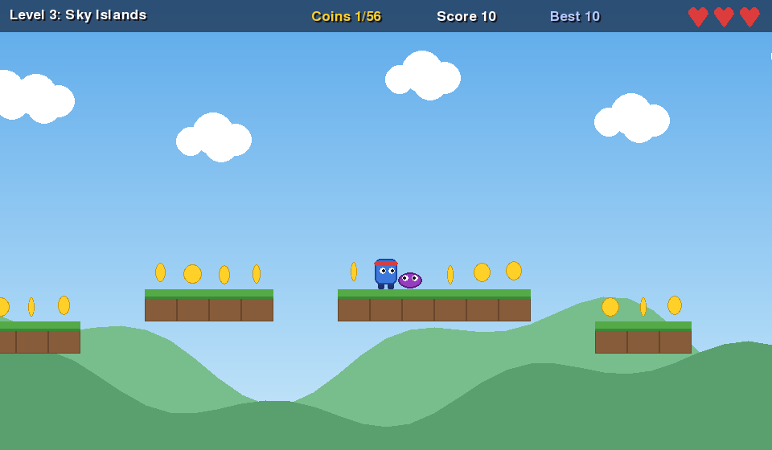

# Coin Runner: a 2D Platform Game in Python

A simple 2D platform game made with Python and pygame. Run, jump, collect coins, stomp enemies, dodge spikes, and reach the flag at the end of each of the three levels.






## Features
- 3 hand-built levels with scrolling camera: Sunny Meadow, Crystal Caves, Sky Islands
- Smooth platformer physics: variable-height jumps, "coyote time" (a late jump still works just after leaving a ledge) and jump buffering (an early jump press still counts)
- Coins, walking enemies you can stomp, spikes, pits, and a goal flag
- 3 lives, invulnerability after a hit, and a return to safe ground after falling into a pit
- Score, bonus for collecting every coin, and a saved high score
- Pause, restart level, mute, and an in-game help screen
- Sound effects generated in code, so no sound files are needed (the game stays silent if there is no sound device)
- No image files either: everything is drawn with code
- Levels are drawn as text, so they are easy to edit
- Automated tests (43), including a check that every level can be finished

## Requirements
- Python 3.10 or newer
- pygame-ce (the community edition of pygame, which also supports the newest Python versions)

Install it with:
```
pip install -r requirements.txt
```
Do not install both `pygame` and `pygame-ce` together. They conflict. If you already installed `pygame`, run `pip uninstall pygame` first.

## How to run
```
python platformer.py
```
If `python` is not recognized on Windows, use `py platformer.py`.

## Controls
| Key | Action |
|---|---|
| Left / Right arrows, or A / D | move |
| Space, Up arrow, or W | jump (hold for a higher jump, tap for a hop) |
| P or Esc | pause (Esc quits from the menu) |
| R (while paused) | restart the level |
| Q (while paused) | back to the menu |
| H | help (menu or pause screen) |
| M | mute or unmute sound |
| Enter or Space | confirm on menus |

## Rules
- Reach the flag to finish a level. The pole is tall, so you cannot jump over it.
- Each coin is worth 10 points, each defeated enemy 100, each finished level 200, and collecting every coin in a level gives a 300 bonus.
- Jump on an enemy from above to defeat it. Touching it from the side, or touching spikes, costs a life.
- Falling into a pit costs a life and puts you back on the last safe ground.
- After a hit you flash and cannot be hurt for 1.5 seconds.
- Lose all 3 lives and the game is over. Your lives and score carry over between levels.

## Tips
- Hold the jump key for a full jump (about 3 tiles high) and tap it for a small hop.
- You can still jump for a split second after running off a ledge.
- Collect coins along the way, because many are placed to show you where to jump.

## Running the tests
```
python -m unittest -v
```
The tests need no window or sound device. They check the physics (gravity, walls, jumping, coyote time, head bumps), the rules (coins, spikes, enemies, pits, flag, game over), the level maps, the high score file, the sound generator, and every game screen. They also play back a recorded winning run on every level, which proves each level can be finished.

## Changing or adding levels
Levels live in `levels.py` and are drawn as text. Every character is one tile:

| Symbol | Meaning |
|---|---|
| `.` | empty space |
| `#` | solid ground or platform |
| `o` | coin |
| `^` | spikes |
| `E` | walking enemy |
| `P` | player start (exactly one) |
| `F` | goal flag (exactly one) |

Every level has exactly 14 rows, and all rows must have the same length. After you edit or add a level, run:
```
python solver.py
```
A computer player tries to finish every level using the real game physics. If it can, it saves the winning runs in `replays.json`, and the tests will pass. If it cannot, your level may be too hard or impossible.

## How it works
- `world.py` holds the game rules and physics, with no drawing, so it can be tested automatically
- `levels.py` holds the level maps
- `platformer.py` holds the window, controls, drawing, sound, menus and high score
- `solver.py` is a computer player that looks ahead using the real physics, to check that levels are possible
- The game runs at 60 frames per second

## Project structure
- `platformer.py`: the game (run this file)
- `world.py`: physics and rules
- `levels.py`: the three levels
- `solver.py`: level playability checker
- `replays.json`: recorded winning runs used by the tests
- `test_platformer.py`: automated tests
- `requirements.txt`: the packages to install
- `screenshots/`: pictures used in this README
- `.gitignore`: files Git should ignore (the saved high score is not uploaded)
- `readme.md`: this file

## Possible future improvements
- More levels, moving platforms, and checkpoints
- Better artwork and music
- A level editor
- Gamepad support
- A packaged `.exe` so people can play without installing Python
